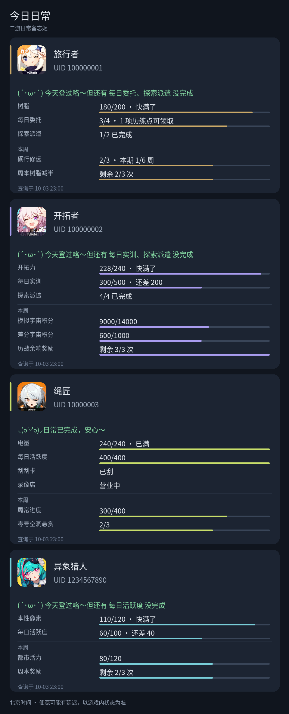
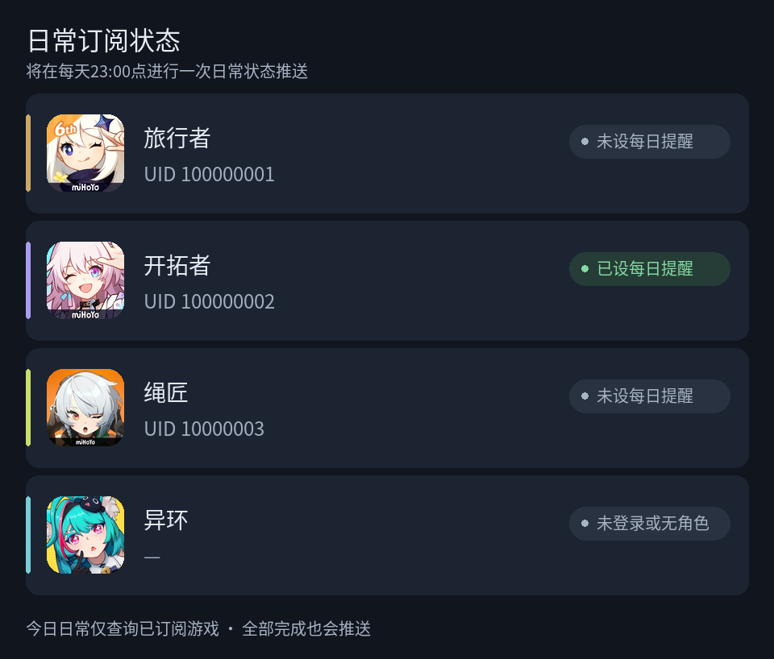
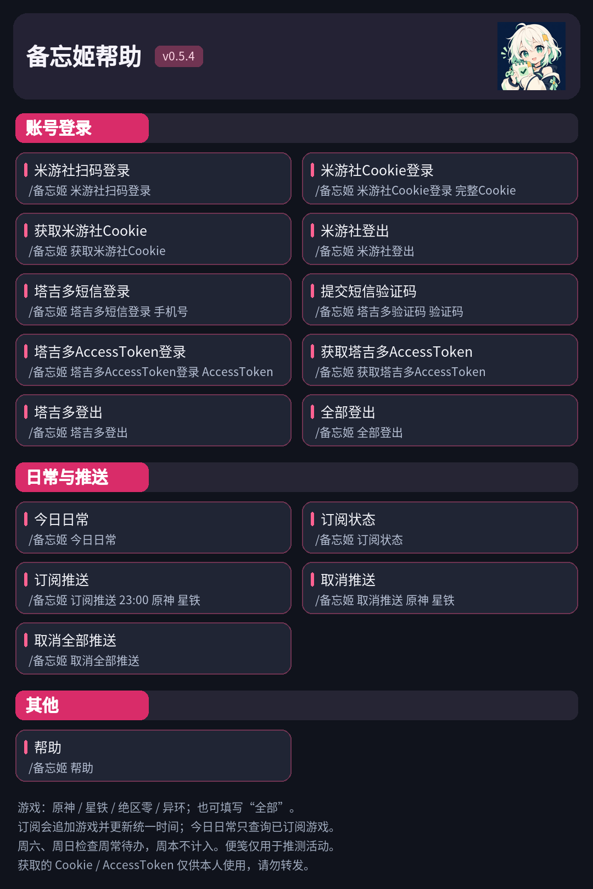

  

<h1 align="center">二游日常备忘姬 v0.5.4</h1>
<h4 align="center">原神 · 星铁 · 绝区零 · 异环 日常查询与定时提醒</h4>

  <a href="#1-丨安装">安装</a> · <a href="#2-丨功能">功能与指令</a> · <a href="#3-丨感谢">感谢</a>

## 1. 丨安装

> 本插件为 **AstrBot** 插件。
>
> ✨如果需要添加更多日常提醒功能欢迎在 [Issues](https://github.com/EyeMelody/astrbot_plugin_daily_reminder/issues) 中提出✨

在 AstrBot 插件管理中通过仓库地址 `https://github.com/EyeMelody/astrbot_plugin_daily_reminder` 安装，或从 [Releases](https://github.com/EyeMelody/astrbot_plugin_daily_reminder/releases) 下载 ZIP 后上传安装。仅支持国服、QQ NapCat / OneBot 私聊，Python 3.11+，AstrBot 4.28.1 至 4.x。

安装后私聊发送 `/备忘姬 帮助`。预览使用模拟数据，真实环境待验证项见 [验证记录](VALIDATION.md)。

## 2. 丨功能

今日日常 - 命令: /备忘姬 今日日常

订阅推送 - /备忘姬 订阅状态

帮助 - /备忘姬 帮助

## 3. 丨感谢

- [Soulter/helloworld](https://github.com/Soulter/helloworld)：AstrBot 官方插件模板。
- [gsuid_core](https://github.com/Genshin-bots/gsuid_core)、[GenshinUID](https://github.com/KimigaiiWuyi/GenshinUID)、[StarRailUID](https://github.com/baiqwerdvd/StarRailUID)、[ZZZeroUID](https://github.com/ZZZure/ZZZeroUID)：米游社协议与游戏字段参考。
- [NTEUID](https://github.com/tyql688/NTEUID)：塔吉多登录与异环数据协议参考。

## 4. 丨其他

- 代码采用 [AGPL-3.0](LICENSE)，复用代码和素材许可见 [NOTICE.md](NOTICE.md)。

- 本项目仅供学习使用，请勿用于商业用途
